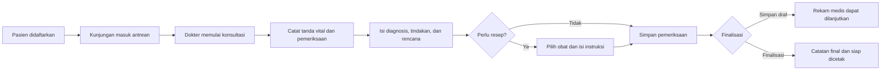

<div align="center">

# Praktik Dokter

### Sistem Informasi Administrasi Pasien

Aplikasi web berbahasa Indonesia untuk membantu tim praktik dokter mengelola pasien, antrean, pemeriksaan klinis, resep, dan aktivitas klinik dalam satu alur kerja.


</div>

---

## Navigasi

- [Tentang aplikasi](#tentang-aplikasi)
- [Fitur utama](#fitur-utama)
- [Alur kerja](#alur-kerja)
- [Teknologi](#teknologi)
- [Menjalankan secara lokal](#menjalankan-secara-lokal)
- [Akun demo](#akun-demo-lokal)
- [Push ke GitHub](#push-ke-github)
- [Keamanan dan privasi](#keamanan-dan-privasi)
- [Pengembangan](#pengembangan)

## Tentang aplikasi

**Praktik Dokter** adalah aplikasi administrasi klinik berbasis Laravel. Sistem menyediakan alur dari pendaftaran kunjungan hingga pencatatan pemeriksaan dan resep, dengan akses yang dibedakan menurut peran pengguna.

> Aplikasi ini membantu administrasi dan dokumentasi. Keputusan diagnosis, tindakan, dan terapi tetap menjadi tanggung jawab tenaga medis yang berwenang.

## Fitur utama

| Area | Kemampuan |
| --- | --- |
| **Dashboard** | Ringkasan aktivitas klinik sesuai peran pengguna. |
| **Pasien** | Pencatatan dan pengelolaan data pasien serta nomor rekam medis. |
| **Pendaftaran & antrean** | Membuat kunjungan, memantau antrean, dan memperbarui status kunjungan. |
| **Pemeriksaan pasien** | Mencatat anamnesis, tanda vital, hasil pemeriksaan, diagnosis, tindakan, dan rencana tindak lanjut. |
| **Resep & obat** | Memilih obat dari katalog, mengisi instruksi resep, dan mencetak hasil yang sudah difinalisasi. |
| **Pemenuhan resep** | Mengelola tindak lanjut pemenuhan resep sesuai kewenangan. |
| **Laporan & notifikasi** | Melihat ringkasan pelayanan dan mengelola pemberitahuan. |
| **Pengguna & peran** | Mengatur akun dan hak akses untuk dokter, resepsionis, dan administrator. |

## Alur kerja



## Teknologi

- **Backend:** PHP 8.3+, Laravel 13
- **Frontend:** Blade, Vite 8, Tailwind CSS 4
- **Database lokal bawaan:** SQLite
- **Hak akses:** middleware dan peran aplikasi
- **Realtime (bila dikonfigurasi):** Laravel Reverb

## Menjalankan secara lokal

### Prasyarat

- PHP **8.3 atau lebih baru** beserta ekstensi yang dibutuhkan Laravel
- Composer 2
- Node.js dan npm dengan versi yang didukung Vite 8
- Git

### 1. Ambil kode sumber

```bash
git clone https://github.com/USERNAME/NAMA-REPOSITORY.git
cd NAMA-REPOSITORY
```

Ganti URL dan nama folder sesuai repository Anda. Jika menggunakan ZIP, ekstrak arsip terlebih dahulu dan buka terminal di folder proyek ini.

### 2. Pasang dependensi PHP dan siapkan konfigurasi

```bash
composer install
cp .env.example .env
php artisan key:generate
```

Di Windows Command Prompt, gunakan `copy .env.example .env` sebagai pengganti perintah `cp`.

### 3. Siapkan database SQLite

Pastikan `.env` memakai `DB_CONNECTION=sqlite`, lalu buat database lokal dan jalankan migrasi beserta data awal:

```bash
# macOS / Linux
touch database/database.sqlite

# Windows PowerShell
New-Item database/database.sqlite -ItemType File -Force

php artisan migrate --seed
```

Seeder membuat peran aplikasi, katalog obat contoh, dan akun demo. Gunakan seeder hanya untuk lingkungan pengembangan.

### 4. Pasang dependensi frontend

```bash
npm ci
```

### 5. Jalankan aplikasi

Buka **dua terminal** pada folder proyek yang sama.

Terminal pertama:

```bash
php artisan serve
```

Terminal kedua:

```bash
npm run dev
```

Buka alamat lokal yang ditampilkan oleh `php artisan serve` (umumnya `http://127.0.0.1:8000`). Untuk membangun aset frontend, jalankan `npm run build`.

## Akun demo lokal

Setelah `php artisan migrate --seed`, akun pengembangan berikut tersedia:

| Peran | Email | Kata sandi |
| --- | --- | --- |
| Dokter / administrator | `dokter.demo@praktik.test` | `password-demo` |
| Resepsionis | `resepsionis.demo@praktik.test` | `password-demo` |

> **Penting:** akun dan kata sandi di atas hanya untuk pengembangan lokal. Jangan aktifkan akun demo di lingkungan produksi.

## Push ke GitHub

### 1. Buat repository GitHub

1. Masuk ke GitHub dan pilih **New repository**.
2. Tentukan nama repository dan visibilitasnya.
3. Untuk menghindari konflik awal, buat repository kosong tanpa README, `.gitignore`, atau license otomatis.
4. Salin URL HTTPS repository yang ditampilkan GitHub.

### 2. Commit dan push branch fitur

Jalankan perintah berikut dari folder proyek. Ganti URL dengan repository Anda.

```bash
git init -b main
git add .
git status
git commit -m "chore: initial project commit"
git remote add origin https://github.com/USERNAME/NAMA-REPOSITORY.git
git switch -c feature/initial-upload
git push -u origin feature/initial-upload
```

Setelah push berhasil, buka repository di GitHub dan buat **Pull Request** dari `feature/initial-upload` ke `main`. Tinjau perubahan sebelum menggabungkannya.

### Push perubahan berikutnya

Untuk mengirim perubahan yang sudah ada di branch kerja:

```bash
git status
git add README.md
git commit -m "docs: update project README"
git push
```

Jika perubahan baru perlu dipisahkan, buat branch terlebih dahulu, lalu push branch tersebut dan ajukan Pull Request:

```bash
git switch -c docs/update-project-readme
git add README.md
git commit -m "docs: update project README"
git push -u origin docs/update-project-readme
```

<details>
<summary><strong>Jika push ditolak karena branch remote memiliki commit baru</strong></summary>

Ambil perubahan terbaru dan rebase branch kerja sebelum mencoba push kembali:

```bash
git fetch origin
git status
git pull --rebase origin NAMA-BRANCH-KERJA
git push
```

Jika terjadi konflik, selesaikan konflik pada file terkait, lanjutkan proses rebase, lalu jalankan kembali tes yang sesuai.

</details>

## Keamanan dan privasi

- Jangan commit `.env`, token, kredensial, kunci aplikasi, atau data pasien.
- `.env.example` hanya template konfigurasi. Simpan nilai rahasia di `.env` lokal atau pengelola rahasia deployment.
- Gunakan data sintetis untuk pengembangan dan demo. Lindungi data kesehatan sesuai kebijakan dan peraturan yang berlaku.
- Ganti kata sandi demo, nonaktifkan akun demo, dan tinjau konfigurasi keamanan sebelum deployment.
- Koreksi catatan pemeriksaan yang telah difinalisasi harus mengikuti prosedur yang dapat ditelusuri.

## Pengembangan

Jalankan tes aplikasi dengan:

```bash
php artisan test
```

Bangun aset frontend dengan:

```bash
npm run build
```

Struktur direktori penting:

```text
app/                 Controller, model, middleware, dan logika aplikasi
database/            Migrasi, factory, dan seeder
resources/views/     Halaman Blade dan komponen tampilan
resources/js/        JavaScript frontend
resources/css/       CSS dan konfigurasi Tailwind
routes/web.php       Definisi route aplikasi
tests/               Tes aplikasi
```

---

<div align="center">

Dibuat untuk mendukung alur administrasi praktik dokter yang lebih tertata.

</div>
